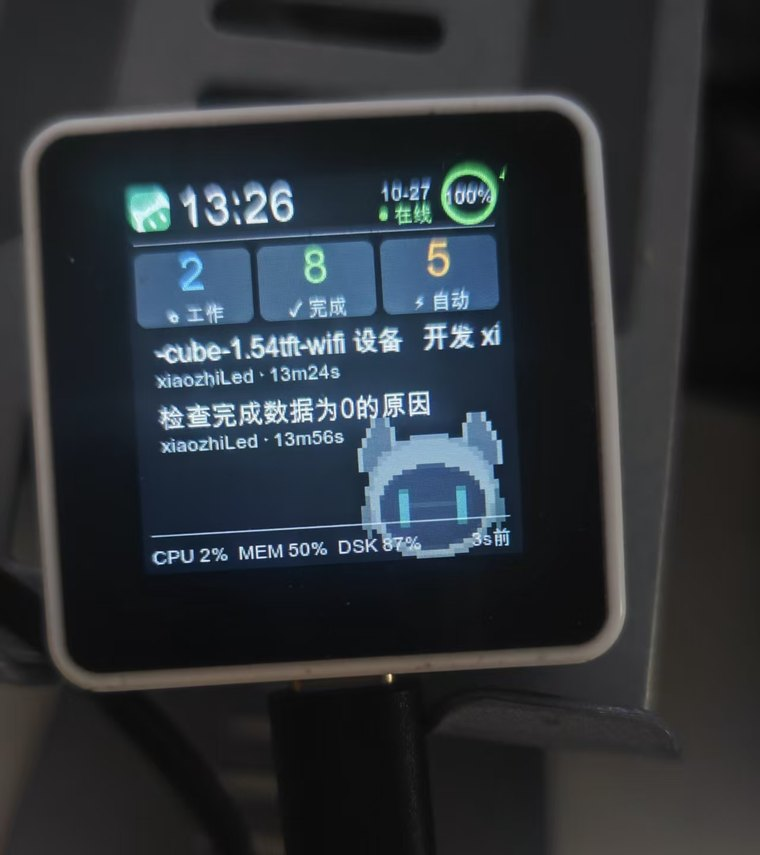
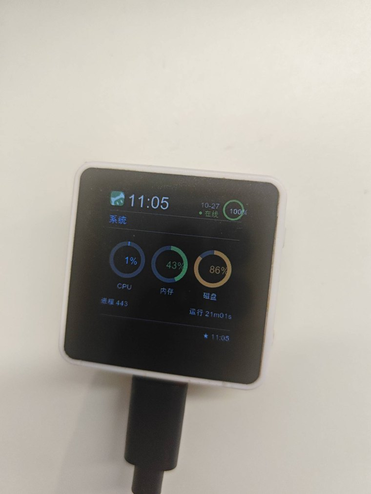
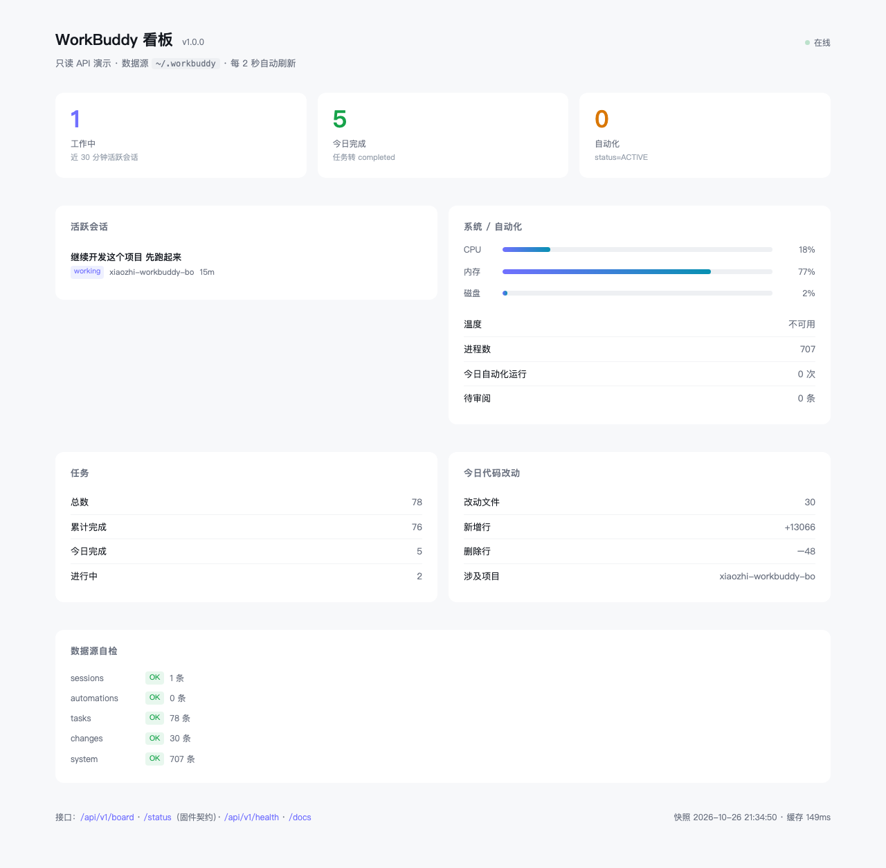
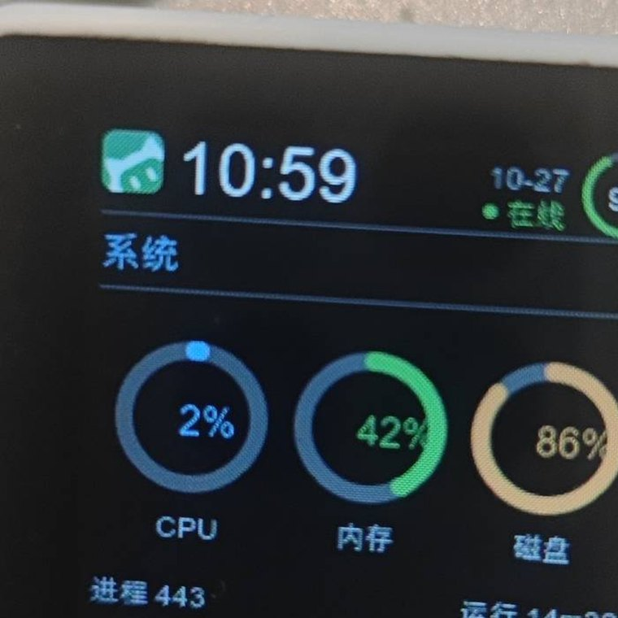
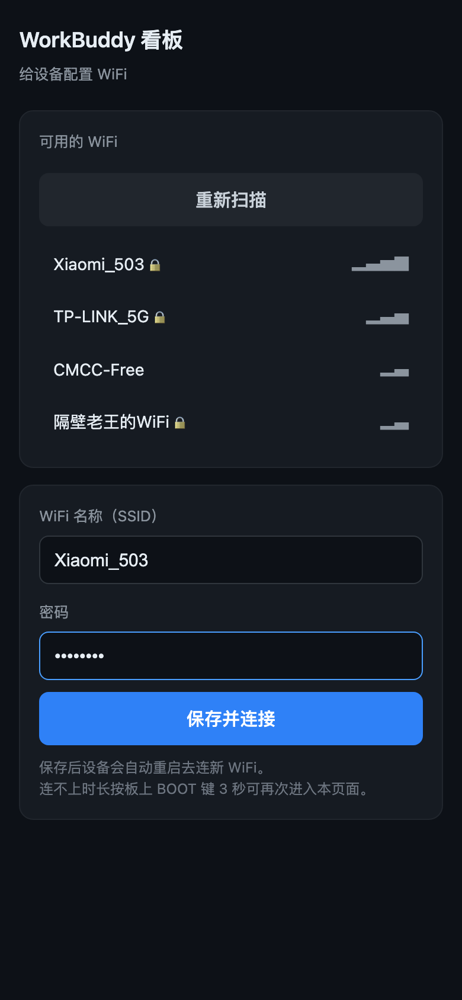

# WorkBuddy 看板 · xiaozhiLed

把 WorkBuddy 的工作状态显示在一块 1.54 寸的 ESP32-S3 小屏上 —— 不打开电脑，抬头就知道 AI 正在干什么。

A real-time status board for WorkBuddy, running on a 1.54" ESP32-S3 panel (ST7789 240×240 + LVGL).

<p align="center">
  
  
</p>

<p align="center">
  <sub>
    左：概览屏 —— 工作中 / 完成 / 自动化三格 + 活跃会话 + 像素宠物，页脚「3s 前」是数据新鲜度<br>
    右：系统屏 —— CPU 蓝 / 内存 绿 / 磁盘 黄，超阈值自动转红
  </sub>
</p>

## 它能看什么

手机上打开同一个服务，还有一份网页版看板 —— 数据同源，手机上也能操作：

<p align="center">
  
</p>

还有一张三环特写，看细节用：

<p align="center">
  
</p>

## 屏幕上的 8 屏

按键 **BOOT** 循环切换，**屏数由服务端下发，改屏数不用重烧固件**：

| 屏 | 内容 |
|---|---|
| 0 | 概览：工作中 / 今日完成 / 自动化 + 活跃会话列表（带状态灯和当前动作） |
| 1 | 任务：总计 / 已完成 / 今日完成 / 进行中 + **正在做的任务标题** |
| 2 | 自动化：已启用 / 今日运行 / 失败 / 待审阅 / 最近一次 |
| 3 | 今日活动：改动文件 / 新增行 / 删除行 / 涉及项目 |
| 4 | 系统：三环图表（CPU / 内存 / 磁盘）+ 进程数 / 运行时长 |
| 5 | Token 用量：今日 / 今日费 / 累计 / 缓存命中率 / 请求数 |
| 6 | 实时：运行中 / 等你 + **每个活跃会话在干什么、已经多久** |
| 7 | 耗时·近30分：近 30 分钟 trace 的累计耗时 Top 5 |

概览屏的会话行首有一颗状态灯：

| 灯 | 含义 |
|---|---|
| 绿灯常亮 | 这个会话正在执行（动作名显示在项目名位置，如"跑命令""等模型"） |
| 黄灯闪烁 | **这个会话卡住了，在等你确认** |
| 不亮 | 空闲 |

第 6 屏「实时」和第 7 屏「耗时」是**两件事**，别混：

- 第 6 屏是**此刻**的状态 —— 谁在跑、谁在等你、已经跑了多久。等你确认的排在最前面。
- 第 7 屏是**近 30 分钟**的累计 —— trace 里刚结束的 span 求和，跟第 6 屏没有对应关系。
  服务重启后这个数会从 0 重新长起来（聚合状态在内存里），不是数据丢了。

页脚显示"更新 Ns 前"，秒针一秒一跳 —— 服务端下发数据年龄，固件本地递增，不是静态时间戳。

```text
WorkBuddy 数据库 ──► 本机服务 :27777 ──WiFi──► ESP32-S3 ──SPI──► ST7789 240×240
   (只读)              采集每 2s              (LVGL)      轮询每 5s
```

三个设计约束决定了这个结构：

- **接口只读内存快照，请求路径上不查库。** SQLite 是 WAL 且被 WorkBuddy 主进程占着，每次请求都查库会拉高锁竞争；采集协程每 2s 刷一次快照，接口直接读内存。采集失败就沿用上一份，屏幕不闪。
- **采集比刷新快一倍多。** 2s 采集 / 5s 刷新，数字不滞后，也不白烧 CPU。
- **屏的内容全在服务端。** 想改显示什么、加减屏，只改 `server/api_server.py` 的 `_screen_rows()`，固件不用动。

## 快速开始

### 1. 启动服务

**Windows**：双击根目录的 `start-board.bat`，出现黑窗口即已启动。

**macOS / Linux**：

```bash
./start-board.sh
```

首次运行会自动建 `.venv` 并装依赖（走阿里云镜像，PyPI 直连常常 SSL 断流）。启动脚本会自动检查依赖和端口占用。

关闭窗口 / `Ctrl+C` = 停止服务。

### 2. 设备上电

插上 USB 线（或接电源）后设备自动连 WiFi、连服务、显示数据，约 5 秒。

新烧的板子第一次开机一定进配网（固件里不烧任何默认 WiFi），配过一次就记住。

## 硬件

| 项目 | 规格 |
|---|---|
| 板子 | 星智 `xingzhi-cube-1.54tft-wifi` |
| 芯片 | ESP32-S3 QFN56 rev0.2 · 8MB PSRAM · 16MB Flash |
| 屏幕 | ST7789 240×240，SPI3 @80MHz |
| 按键 | BOOT (GPIO0) / VOL+ (GPIO40) / VOL- (GPIO39) |
| 电池 | ADC2_CH6 → GPIO17，充电检测 GPIO38 |

引脚定义在 `firmware/main/board_config.h`，含一颗坑：**I2S 音频脚（GPIO 4/5/6/7/15/16）绝对不要调 `gpio_config()` 或加内部上下拉** —— 它们被 codec 偏置在 VDD/2，被误采样会让功放发出噪音。

`adc-probe/` 和 `probe-spk/` 是两个独立的硬件探针工程（电池 ADC 曲线、喇叭音色调试），不参与看板固件构建。

## 按键的三种语义

按当时网络状态自动分流，不用记模式：

| 操作 | 联网正常 | WiFi 连不上 | 服务连不上 |
|---|---|---|---|
| 短按 | 下一屏 | 下一屏 | 下一屏 |
| 长按 3 秒 | 调亮度（700ms 起循环） | 进配网 | 重开服务地址配置页 |

设计意图：配网会中断数据轮询，联网状态下不该被误触，所以长按只在需要自救时改变语义。

## 换 WiFi（手机配网，不用重烧固件）

WiFi 凭据存在板子的 NVS 里，换网络不需要重新编译。长按 BOOT 3 秒进配网，手机连上热点后打开 `192.168.4.1` 就是这个页面：

<p align="center">
  
</p>

### 什么时候会提示配网

开机连不上（重试 4 次约 16 秒）后，屏幕上出现：

```text
        WiFi 未连接
        小米路由器_5G
      长按 BOOT 3 秒
      进入配网模式
     用手机配置 WiFi
```

一次都没配过（NVS 空且没有编译期默认值）的设备，**开机会直接进配网**。

### 配网步骤

1. **长按板上 BOOT 键 3 秒**（只在**未联网**时生效）
2. 屏幕切到配网页，显示热点名和配置地址：

   ```text
          配网模式
        WorkBuddy-A1B2      ← 热点名（带 MAC 后两字节）
         192.168.4.1        ← 配置页地址
      手机连上面这个热点
        （不需要密码）
   ```

   热点是**开放网络，不设密码** —— 省掉在小屏上念一串密码的麻烦。手机连上之后地址会变绿并提示"手机已连接"。

3. 手机 WiFi 列表里连 `WorkBuddy-XXXX`（无需密码）
4. 浏览器打开 `http://192.168.4.1/`，点扫描 → 选你家 WiFi → 输密码 → 保存
5. 板子自动重启，连上新 WiFi

> 配网页空闲 3 分钟会退出配网 —— 防止误触发把设备卡住。但**只有已经存过凭据**时才重启；一次都没配过的设备会一直等，否则会变成"开机→配网→3 分钟→重启→配网"的死循环。

### 凭据从哪来

```text
NVS 里存过  →  用 NVS 的
NVS 没有    →  开机直接进配网
```

**固件里不烧任何默认 WiFi。** 2026-10-27 起取消了编译期兜底：`config.local.h` 只剩 `BRIDGE_BASE`（服务地址），不再有 `WIFI_SSID` / `WIFI_PASSWORD`。理由是一套默认密码既换环境就要重烧，又把密码带进了构建产物。

实现集中在 `firmware/main/wifi_mgr.{h,cpp}`：NVS 凭据、STA 重连、SoftAP、配网 HTTP 服务（含内嵌页面）都在里面。屏幕只认 `wifi_mgr_state()` 的四个状态，判断口径集中在一处，改连接逻辑不用动 UI。

## 换服务地址（电脑 IP 变了不用重烧）

服务地址（`BRIDGE_BASE`）同样存在 NVS 里。

### 什么时候会提示

**WiFi 通了但服务还没拉通**时，屏幕先给出"正在连接服务"，并把正在连的地址写在下面：

```text
      正在连接服务
    192.168.0.89:27777      ← 正在连的服务器地址
  请确认电脑上的服务已启动
    连上后会自动进入看板
```

正常开机这一步一闪而过：首连要等 2 秒才显示，那会儿首轮请求早就回来了，不会遮挡看板。连上过又掉线的（服务重启 / 电脑休眠），要连续失败 2 次（约 10 秒）才提示 —— 单次超时不闪屏。

还是连不上，连续 5 次（约 30 秒）后转成"服务连不上"，这时才给出配置页地址和验证码：

```text
       服务连不上
    192.168.0.89:27777      ← 现在用的地址（旧 IP）
      192.168.1.23          ← 配置页地址（绿，设备自己的 IP）
   用浏览器打开上面地址
  照着下面的数字填验证码
  验证码 1234 · 4:59        ← 5 分钟内有效，屏上倒计时
```

同时设备在**已连上的 WiFi** 上开一个配置页 —— 不用切热点、不用重启、不中断看板，手机或电脑连同一个 WiFi 就能直接访问。

### 改地址步骤

1. 浏览器打开屏幕上那个绿色地址
2. 在「服务地址」里填电脑 IP，**端口单独一栏**（留空即用默认 27777，不写 `http://` 也认）
3. 把屏幕上的 4 位验证码填进表单（5 分钟内有效，屏上有倒计时）
4. 点保存 —— **几秒内生效**，屏幕上那块提示自动消失

拉通一次之后配置页自动关闭；还是连不上就一直开着，随时能改。忘了地址也没关系：**长按 BOOT 3 秒**可以重新打开配置页。

配网热点那个页面里也有同一栏「服务地址」，第一次配 WiFi 时可以顺手填好。

### 地址从哪来

```text
NVS 里存过  →  用 NVS 的
NVS 没有    →  用编译期 BRIDGE_BASE（config.local.h 的兜底值）
```

`configure.py` 只负责写这个兜底值。地址每轮轮询现读，所以改完下一轮就生效；连续失败计数也在 `wifi_mgr.cpp`，屏幕只认 `wifi_mgr_svr_down()`。

## HTTP 接口

| 地址 | 说明 |
|---|---|
| `http://127.0.0.1:27777/` | 网页演示页（手机也能开） |
| `http://127.0.0.1:27777/docs` | OpenAPI 文档 |
| `/status` | 固件概览屏（第 0 屏） |
| `/screen/<i>` | 固件详情屏（第 1..N-1 屏），按键时按需拉取 |
| `/api/ticker` | 滚动条纯文本 |
| `/api/v1/board` | 聚合快照（网页演示页用） |
| `/api/v1/{summary,sessions,tasks,automations,activity,artifacts,system,tokens}` | 明细接口 |
| `/api/v1/live` | **实时工作状态**：正在跑什么 / 卡在哪等你确认 / 累计耗时 |

两个固件契约上的硬限制，改服务端时别踩：

- **单个响应体不能超过 4096 字节**（固件 `HTTP_BUF_SIZE`）。超了会被静默截断 → JSON 不完整 → 解析出脏数据。
- **`date` 字段必须是纯 ASCII**（固件 buffer 只有 8 字节），所以下发的是 `MM-DD` 而不是本地化字符串。

`/status` 的 `nscr` 字段决定设备能按出几屏，`kind` 字段决定哪一屏用图表渲染 —— 固件按字段判断，不认屏号，所以换图表屏不用改固件。

会话行里的 `st` / `act` 是**可选键**：`st` = 0空闲 / 1运行中 / 2等你确认，`act` = 当前动作的中文名。
旧固件不认这两个键会直接忽略，新固件读老服务端会因为缺省值退化成"空闲" —— 双向兼容，不用同步升级。

### 实时状态的数据从哪来

全在本地，不查云端：

| 信号 | 来源 | 判定 |
|---|---|---|
| 正在执行 | `~/.workbuddy/projects/*/<sessionId>.jsonl` | 有未配对的 `function_call`，且距今 < 90 秒 |
| 等你确认 | 同上 | 同上，但距今 > 90 秒（工具是 `AskUserQuestion` 时优先标黄） |
| 累计耗时 | `~/.workbuddy/traces/<pid>/trace_*.jsonl` | span 的 `duration` 求和 |

两个踩过的坑，源码里都有注释：

- **trace 文件在回合结束时才一次性落盘**，运行中根本不存在 —— 所以"正在执行"不能看 trace 的未闭合 span（实测 739/739 全闭合），必须看会话日志的增量写入。
- **trace 文件名里的 traceId 和会话日志的 `providerData.traceId` 是两套完全不同的 id**（实测 571 个 trace 零重叠），所以耗时只能靠 pid 归属，`durations` 只对**当前活跃**的会话可靠；屏上展示资源消耗请用 `tool_totals`（全局聚合）。

## 自检

服务跑起来后一键回归：

```bash
python scripts/check_api.py      # 端点矩阵 + 固件契约 + 数据源自检 + 详情屏
python scripts/shot_board.py     # 截图演示页，确认真实渲染
```

## 改固件（一般用不到）

### macOS（已跑通，推荐）

ESP-IDF v6.1 装在 `~/.espressif/v6.1/esp-idf`（EIM 装的，submodule 齐全）。

```bash
export IDF_PATH=~/.espressif/v6.1/esp-idf
source $IDF_PATH/export.sh

cd firmware
idf.py -DIDF_TARGET=esp32s3 build            # 编译
idf.py -p /dev/cu.usbmodem21201 flash        # 烧录
idf.py -p /dev/cu.usbmodem21201 monitor      # 看日志，Ctrl+] 退出
```

串口是 ESP32-S3 原生 USB-Serial/JTAG，设备名形如 `/dev/cu.usbmodem*`（用 `ls /dev/cu.*` 查）。

### Windows

```bash
toolchain/build-firmware.sh                  # 编译
toolchain/flash-board.sh COM5 460800         # 烧录（设备插在 COM5）
```

> **编译时别用管道接输出**（`... | tail`）。Git Bash 下会因回压把 ninja 挂死，表现为编译到一半不动、CPU 也不涨。一律重定向到文件：`idf.py build > build.log 2>&1`。

> **直接调 `ninja` 会失败**。`build.ninja` 一旦判定需要重新 configure，就会再跑一遍 CMake，而裸 shell 里没有 `IDF_PATH`，报 `include could not find requested file: /tools/cmake/project.cmake`（注意路径开头是 `/tools` —— `IDF_PATH` 是空的，拼出来的路径就丢了一半）。所以编译**一律走 `toolchain/build-firmware.sh`**，它负责导出 `IDF_PATH` / `ESP_ROM_ELF_DIR` 等一整套环境。

### ESP-IDF 装在哪（重要）

**不在本项目里。** 三个脚本里的 `IDF_PATH` 都硬编码指向系统级安装位置：

| 平台 | 路径 | 版本 |
|---|---|---|
| Windows | `C:\esp\v6.1\esp-idf`（约 696MB） | v6.1 |
| macOS | `~/.espressif/v6.1/esp-idf` | v6.1 |

`toolchain/` 目录**只放脚本，共 50KB**。2026-10-27 之前这里曾残留两套没被引用的 IDF 源码（`esp-idf/` 273MB + `esp-idf-git/` 1.2GB，共吃掉 1.5GB），已清理。判据是：`firmware/build/CMakeCache.txt` 里 `CMAKE_TOOLCHAIN_FILE` 与各 `_SOURCE_DIR` 全部指向 `C:/esp/v6.1/esp-idf`，全仓无一处引用 `toolchain/esp-idf*`。

所以 **`C:\esp\v6.1\esp-idf` 是编译硬依赖**，清 C 盘或换机器时别顺手删掉，否则编译直接挂。

### 写服务地址兜底值

```bash
python configure.py -i 192.168.x.x                    # 端口留空 → 默认 27777
python configure.py -i 192.168.x.x --port 8080        # 非默认端口
python configure.py -b 192.168.x.x:27777              # 老写法，仍然支持
```

它把 `BRIDGE_BASE` 宏写进 `firmware/main/config.local.h`（不进版本库），并校验服务是否真的可达。路径由固件自己拼 `/status` 或 `/screen/<i>` —— 别改这个宏名。

## 字库（屏幕出现方格时看这里）

三套 LVGL 点阵字库，由 `tools/gen_fonts.py` 生成：

| 字号 | 变量 | 用在哪 | 字符集 |
|---|---|---|---|
| 12px | `font_cn_12` | 元信息、列表值、页脚、配网提示 | 3828 字 |
| 16px | `font_cn_16` | **会话标题**、行标题、配网提示 | 3828 字 |
| 28px | `font_cn_28` | 时钟、大数字、配网标题 | 232 字 |

**28px 故意只给 232 字**：它只显示时钟和两三句提示，喂全量字符集会让它从约 90KB 涨到 214KB —— 三个字库里它最贵，纯浪费 Flash。

12/16px 的 3828 字 = **GB2312 一级常用汉字 3755 个**（覆盖日常用字 99.7%）＋ 固件源码里的全部中文字符串 ＋ 服务端真实下发内容 ＋ ASCII ＋ 界面符号。

### 出现方格怎么办

方格 = 字库不含那个字。按顺序做：

```bash
# 1. 重新收集字符（扫源码 + 拉服务端全部接口 + 读数据库历史标题）
python tools/gen_charset.py

# 2. 重新生成字库
python tools/gen_fonts.py

# 3. 重新编译烧录
cd firmware && idf.py -DIDF_TARGET=esp32s3 build && idf.py -p <串口> flash
```

`gen_charset.py` 输出两份：`tools/charset.txt`（12/16px 用）和 `tools/charset_ui.txt`（28px 用）。还缺字就把它加进 `EXTRA_PUNCT` 或直接追加到 `charset.txt` 末尾，再跑第 2 步。

### 字体依赖

`gen_fonts.py` 会自动找系统字体，也可用环境变量指定：

| 平台 | 中文 | 符号 |
|---|---|---|
| Windows | `C:/Windows/Fonts/simhei.ttf` | `seguisym.ttf` |
| macOS | `/System/Library/Fonts/Supplemental/Arial Unicode.ttf` | `Apple Symbols.ttf` |

```bash
LV_FONT_CJK=/path/to/font.ttf LV_FONT_SYM=/path/to/sym.ttf python tools/gen_fonts.py
```

首次生成前要装 `lv_font_conv`：

```bash
cd tools && npm install --registry=https://registry.npmmirror.com
```

两个字体上的坑：

- ⚠ macOS 的 `Hei.ttf`（SIL-Hei，形似黑体）**不能用** —— 缺 OS/2 表，`lv_font_conv` 直接报 `os/2 table not found`。用 Arial Unicode。
- ⚠ 彩色 emoji 字体（Apple Color Emoji / Segoe UI Emoji）不支持 —— `lv_font_conv` 只能处理单色字形，彩色字体会被渲染成实心黑块。

## 跨平台

服务和固件在 Windows / macOS / Linux 上都能跑，差异只在启动方式、串口名和工具链位置：

| | Windows | macOS | Linux |
|---|---|---|---|
| 启动服务 | `start-board.bat` | `./start-board.sh` | `./start-board.sh` |
| Python | `py`（依赖装在这） | `.venv`（脚本自动建） | `.venv`（脚本自动建） |
| 串口 | `COM5` 等 | `/dev/cu.usbmodem*` | `/dev/ttyUSB0` 等 |
| ESP-IDF | `C:\esp\v6.1\esp-idf` | `~/.espressif/v6.1/esp-idf` | 自行安装 |

验证脚本通用，命令行传串口名即可：

```bash
python scripts/check_api.py                    # 纯标准库，三平台一致
python scripts/shot_board.py                   # 需 playwright
python scripts/serial_read.py <串口> 30         # 需 pyserial
```

开发工具依赖单独放 `server/requirements-dev.txt`（playwright + pyserial），服务本身只需要 `server/requirements.txt`。路径判定已做成平台无关：`server/sources/files.py` 的噪音过滤会把 `\` 和 `/` 归一后比对。

仍是单平台的工具（不影响正常使用）：`tools/idfwrap.py`（Windows 专用，绕 IDF 路径长度问题）、`tools/watch_serial.py`（默认 `COM5`，其他平台传参）。

## 已知限制

- **温度显示不了**（`--`）：psutil 取不到传感器，属正常。
- **依赖本机开着服务**：服务一停，设备 5s 后显示"离线"，数据保留不清零。
- **服务连不上时配置页一直开着**：连续 5 次拉不到服务后，配置页（HTTP 80）会在局域网里一直开到拉通为止，这是刻意的取舍 —— 地址不对时这个页面正是唯一的自救入口。在意的话可以给 `h_index` 加个简单口令。
- **USB 串口工具会干扰 BOOT 按键**：GPIO0 是 ESP32-S3 的启动 strapping 脚，板上自动复位电路在 DTR 拉低时会把它带下去，开着串口终端时可能误判成按键。正常插电不受影响；真误进了配网，3 分钟没人访问会自动重启退出。
- **配网热点是开放网络（无密码）**：只在配网窗口期（最长 3 分钟）存在，不承载数据。若在意这 3 分钟内被旁人连入，可把 `wifi_mgr.cpp` 里 `ap.ap.authmode` 改回 `WIFI_AUTH_WPA2_PSK` 并设 `ap.ap.password`。
- **字库不含的字会显示成方格**：按「字库」一节重跑 `gen_charset.py` → `gen_fonts.py` 再烧录。
- **国内装 ESP-IDF 要用镜像**：`github.com` 常连不上，只有 `codeload.github.com`、`api.github.com` 和乐鑫 CDN 能连。工具链下载加环境变量 `IDF_GITHUB_ASSETS=dl.espressif.com/github_assets` 走乐鑫 CDN（实测 3MB/s）。若只有 GitHub tarball 没有完整包，可用 `tools/fetch_idf_submodules.py` 按 SHA 逐个补 submodule。

## 目录

| 目录 | 内容 |
|---|---|
| `server/` | 数据服务（FastAPI，只读 WorkBuddy 数据库），`sources/` 下分 db / files / ledger / system / tokens 五个数据源 |
| `firmware/` | 看板固件（ESP-IDF + LVGL）。`main/` 按职责分文件：`main.cpp`（入口 + LVGL 任务编排 + 按键回调适配，288 行）、`ui_board.cpp`（建屏 / 渲染 / 切屏 / 休眠 / 浮层）、`board_display.cpp`（SPI / ST7789 / LVGL display / 背光）、`data_fetch.cpp`（取数）、`board_json.cpp` + `board_data.cpp`（解析 / 数据结构与共享快照）、`buttons.cpp`（按键）、`pet_view.cpp`（像素宠物）、`device_report.cpp`（温度上报）、`text_util.cpp`（字体工具）、`wifi_mgr.cpp`（联网与配网页） |
| `docs/` | 需求文档与图片资源 |
| `tools/` | 字库 / Logo / 宠物帧 / 音色生成脚本 |
| `scripts/` | 自检、截图、串口读取 |
| `reference/` | 上游板卡参考资料（不进构建） |
| `adc-probe/`、`probe-spk/` | 硬件探针工程（电池 ADC、喇叭调试） |
| `toolchain/` | 编译与烧录脚本，共 50KB（不进版本库）。**不含 ESP-IDF 源码** —— IDF 装在本机全局路径，见下方「ESP-IDF 装在哪」 |
