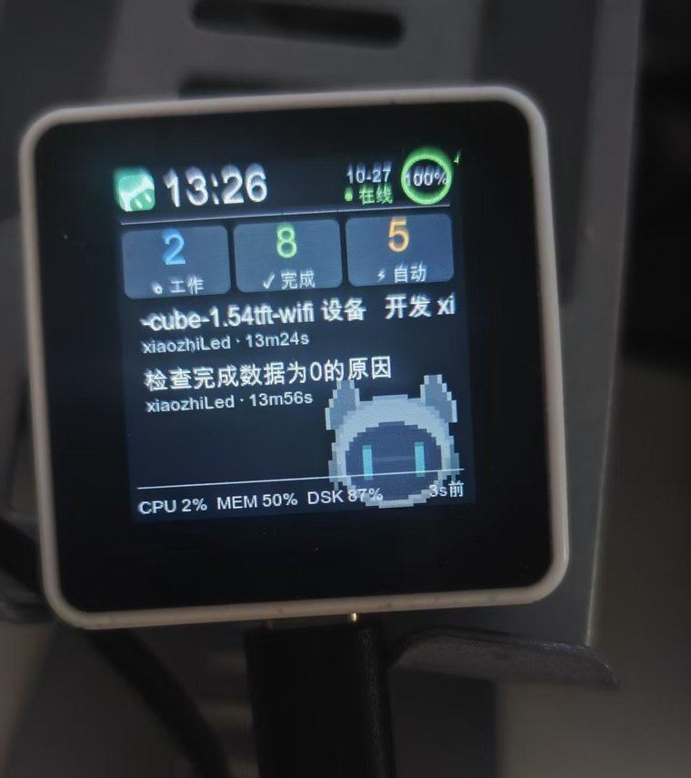

# WorkBuddy 看板 · xiaozhiLed

把 WorkBuddy 的工作状态显示在一块 1.54 寸的 ESP32-S3 小屏上 —— 不打开电脑，抬头就知道 AI 正在干什么。

A real-time status board for WorkBuddy, running on a 1.54" ESP32-S3 panel (ST7789 240×240 + LVGL).

<p align="center">
  
</p>

## 架构

**纯蓝牙直连，不走 WiFi、不开 HTTP 服务。** 电脑上的主机端（`host/wb_app.py`）读 WorkBuddy 本地数据，
通过 BLE 推给设备；设备按键的回传（审批、作答）也走同一条链路回来。

```text
WorkBuddy 本机数据 ──► host/wb_app.py ──BLE──► ESP32-S3 ──SPI──► ST7789 240×240
  (~/.workbuddy)         (主机端)      notify      (LVGL)
                                       ◄────────
                                       write（审批 / 作答回传）
```

三条设计约束决定了这个结构：

- **数据帧由主机端主动推，设备不拉取。** 设备没有 WiFi、没有 HTTP 客户端，
  唯一的上行通道是 BLE notify，用来回传按键决定。
- **一帧一屏，内容全在主机端。** 想改屏上显示什么只改 `host/wb_app.py` 的下发逻辑，固件不用动。
- **能力位协商（caps）。** 设备连上后先发 hello 报自己认哪些帧
  （审批页 / 提问页 / 多选 / 计数语义 …）。主机据此决定要不要发相应特性，
  老固件不会被新帧卡得没法用。

### 为什么之前是 WiFi/HTTP，现在是蓝牙

2026-10-31 之前用的是 `WiFi → 本机 HTTP 服务(:27777) → 设备轮询`。那套结构的问题：

- 设备要自己配 WiFi（配网流程、凭据存 NVS、换网络要重配）——
  **一块只用来看状态的屏，配网这件事本身就比它的价值重**；
- 电脑休眠 / 换 IP / 服务重启都会让屏变"离线"，而这些跟"AI 在干什么"无关；
- HTTP 轮询有 2~5 秒延迟，审批/作答这类交互等不起。

蓝牙直连后这些都消失了：不需要配网，电脑在附近就能连，交互延迟降到百毫秒级。
旧的 WiFi/HTTP 实现整体归档在 `archive/`（`README-legacy-http.md`、`legacy-entrypoints/`），
需要时可以从 git 历史找回。

## 屏幕有哪些页

**4 个导航页**用短按循环切换，长按退回上一页：

| 页 | 标题 | 内容 |
|---|---|---|
| 1 | 配额总览 | 剩余配额 / 已用 / 今日消耗 + 环形进度 |
| 2 | 会话列表 | 活跃会话卡（状态灯 + 项目名 + 当前动作 + token） |
| 3 | 运行详情 | 正在跑的会话：模型 / 已运行时长 / 阶段 / 进度条 |
| 4 | 今日消耗 | 今日总量 + 请求数 + 缓存命中率 + 按模型分布 |

还有 **3 个功能页**，由主机下发的事件自动弹出（优先级高于导航页）：

| 页 | 触发 | 操作 |
|---|---|---|
| 命令审批 | 主机发 `approval` 帧 | 短按 = 允许，长按 = 拒绝 |
| 请选择 | 主机发 `ask` 帧 | 短按 = 下一个选项，长按 = 选定提交 |
| 待机（大眼睛） | 本地空闲满 3 分钟且无人干活 | 任意键唤醒 |

单键板只有两种手势（短按 / 长按），所以：

- **审批页一进去就能按** —— 短按允许、长按拒绝，不做二级确认；
- **提问页不画 `[ ]/[x]` 勾选框** —— 没有第三种手势去勾选，
  所以固件**不实现多选**，`WB_CAPS` 里也不声明 `CAP_ASK_MULTI`。
  主机侧用同一套能力位降级为单选（双保险，避免"设备停在死页面怎么按都没反应"）。

### 提示音

五段语义，全部离线渲染成 PCM 直驱功放（24kHz 单声道，运行时零重采样）：

| 事件 | 音 |
|---|---|
| 任务完成 | DONE |
| 等待操作（审批 / 提问） | ATTENTION |
| 连上主机 | CONNECTED |
| 会话收工 | SESSION_END |
| 按键 | KEY（-6dB，刻意不喧宾夺主） |

素材是 CC0 音源，由 `tools/tones/gen_tones_multistruct.py` 按素材原结构生成，
数据表在 `firmware/main/tone_pcm.h`（自动生成，勿手改）。

## 快速开始

### 1. 启动主机端

**必须双击 `host/启动主机端.command`，不要从 IDE / 后台 shell 启动。**

macOS 的 TCC 隐私沙盒要求「蓝牙」权限绑定在**有 GUI 会话的前台应用**上。
从后台跑 python，CoreBluetooth 一扫描就被系统 `SIGABRT` 掉
（崩溃报告里是 `TCC_CRASHING_DUE_TO_PRIVACY_VIOLATION`）。Terminal.app 已有蓝牙授权，
经由它启动的子进程才合法。

```bash
双击 host/启动主机端.command
# 或
./host/启动主机端.command              # 前台运行
./host/启动主机端.command --stop       # 停止已在运行的实例
WEB_PORT=9090 ./host/启动主机端.command # 改 Web UI 端口（默认 8080）
```

依赖：`bleak`（蓝牙）、`pystray` + `Pillow`（托盘图标）、`certifi`。
脚本会自动挑一个装了这些的 Python；缺了会给出安装命令。

### 2. 设备上电

插 USB 或接电源，设备自动开始 BLE 广播，主机端扫描到就连上（约 3~20 秒）。
连上后设备会发 hello，主机回 welcome + 首帧状态。

**不需要配网。** 新架构没有 WiFi。

### 3. 看 Web 控制台

主机端自带一个网页控制台（`http://127.0.0.1:8080`），可以看日志、推测试帧、改提示音音量。
它和设备的屏共用同一份数据源。

**用手机/别的设备看（可选）**：把 Web 控制台监听放开到局域网，手机连同一 WiFi 就能访问
`http://<本机IP>:8080`（浏览器或 `wbboard/` 打包的 APK 均可）：

```bash
# Windows（项目 venv，含 bleak/pystray；必须用它，别用裸 py 否则 daemon 起不来）
cd host
./.venv/Scripts/python.exe wb_app.py --web-host 0.0.0.0 --web-port 8080

# macOS（便捷脚本已支持 WB_HOST，一行放开监听；端口仍默认 8080）
WB_HOST=0.0.0.0 ./host/启动主机端.command
```

启动日志会打印「手机端填 http://<局域网IP>:8080」。注意放开 `0.0.0.0` 后，
控制台无鉴权，同网段任何设备都能访问 —— 家用 WiFi 无妨，公共/公司网络慎开。
想随时改地址而不重打包，用 `wbboard/dist/wbboard-debug.apk`（原生 WebView 壳，
内置地址配置页，长按返回键可改地址）。

## 硬件

| 项目 | 规格 |
|---|---|
| 板子 | 星智 `xingzhi-cube-1.54tft-wifi` |
| 芯片 | ESP32-S3 QFN56 rev0.2 · 8MB PSRAM · 16MB Flash |
| 屏幕 | ST7789 240×240，SPI3 @80MHz |
| 按键 | BOOT (GPIO0) —— 单键板，只有短按 / 长按 |
| 音频 | I2S 直驱功放：BCLK=GPIO15 / LRCK=GPIO16 / DOUT=GPIO7 |
| 电池 | ADC2_CH6 → GPIO17，充电检测 GPIO38 |

引脚定义在 `firmware/main/board_config.h`，含一颗坑：**I2S 音频脚（GPIO 4/5/6/7/15/16）绝对不要调 `gpio_config()` 或加内部上下拉** —— 它们被 codec 偏置在 VDD/2，被误采样会让功放发出噪音。

`probes/adc-probe/` 和 `probes/probe-spk/` 是两个独立的硬件探针工程（电池 ADC 读数验证、喇叭引脚探测），不参与正式固件构建。

## 改固件

### macOS（已跑通）

ESP-IDF v6.1 装在 `~/.espressif/v6.1/esp-idf`（EIM 装的，submodule 齐全）。

```bash
export IDF_PATH=~/.espressif/v6.1/esp-idf
source $IDF_PATH/export.sh

cd firmware
idf.py -DIDF_TARGET=esp32s3 build            # 编译
idf.py -p /dev/cu.usbmodem21201 flash        # 烧录
idf.py -p /dev/cu.usbmodem21201 monitor      # 看日志，Ctrl+] 退出
```

串口是 ESP32-S3 原生 USB-Serial/JTAG，设备名形如 `/dev/cu.usbmodem*`（用 `ls /dev/cu.*` 查）。

> ⚠ **别用 `~/esp/esp-idf-v5.5.3`** —— 它会报工具链版本不匹配（要 `esp-14.2.0_20251107`）。
> 必须用 `~/.espressif/v6.1/esp-idf` + 工具链 `esp-15.2.0_20251204`。

> ⚠ **编译时别用管道接输出**（`... | tail`）。会因回压把 ninja 挂死，
> 表现为编译到一半不动、CPU 也不涨。重定向到文件：`idf.py build > build.log 2>&1`。

### 编译开关

| 开关 | 默认 | 说明 |
|---|---|---|
| `WB_BLE_ONLY` | **ON** | 只走蓝牙，不启动 WiFi / HTTP 轮询 |
| `WB_PREVIEW_DATA` | OFF | 界面用假数据渲染，仅供版式自检 |

```bash
idf.py -DWB_BLE_ONLY=0 build     # 回退到 WiFi 版本（需配合旧 server，已归档）
idf.py -DWB_PREVIEW_DATA=1 build # 版式自检
```

### ⚠ 串口监听会重启设备

用 pyserial 打开 `/dev/cu.usbmodem*` 时**设备会重启**（ROM 引导日志从头刷）。
所以**别在"等用户按键 / 观察屏幕"的窗口里开串口** —— 会把要观察的状态清掉。
这条踩过坑：一次"多选没作答"的误判，就是因为监听串口把设备重启了。

## 测试

一键跑全部回归：

```bash
./tests/run_all.sh
```

9 套件，主机侧（Python，直接 import 真实的 `host/wb_app.py`）+ 固件侧（C，直接编译真实的
`wb_core.c` / `wb_proto.c` / `wb_json.c`）：

| 套件 | 覆盖 |
|---|---|
| `test_encode_cwd` | 路径编码（macOS / Windows / 真实目录命中） |
| `test_host_ask` | `_decode_ask_picks` 解码（index / mask / 越界） |
| `test_ask_flow` | `_handle_ask_answer` 全分支 |
| `test_multi_negotiate` | `CAP_ASK_MULTI` 能力协商与多选降级 |
| `test_transcript_scan` | 转录增量扫描（提问可见性） |
| `test_ask` | 提问页协议 + 状态机 |
| `test_usage_frame` | usage 帧解码 |
| `test_standby` | 待机页 |
| `test_multi_downgrade` | 固件侧多选降级（`WB_CAPS` 口径） |

固件侧测试只链接核心层，**不含 `wb_view.c`**（它依赖 LVGL，需要 ESP-IDF 环境才能编）。

### 排查提问链路（`tools/ask-debug/`）

设备"有声音但没弹提问框"这类问题，按顺序用：

```bash
python3 tools/ask-debug/scan_ask_transcript.py   # 有没有未闭合提问
python3 tools/ask-debug/scan_ask_timeline.py     # 每次提问的时间线与距末尾距离
python3 tools/ask-debug/measure_ask_gap.py       # 量「提问→闭合」间隔
python3 tools/ask-debug/verify_ask_scan.py       # 用生产代码扫真实转录
python3 tools/ask-debug/verify_ask_e2e.py        # 拿真实提问做新/旧对照
python3 tools/ask-debug/repro_ask_push.py        # 此刻会推什么
```

## 字库（屏幕出现方格时看这里）

三套 LVGL 点阵字库，由 `tools/fonts/gen_fonts.py` 生成：

| 字号 | 变量 | 用在哪 | 字符集 |
|---|---|---|---|
| 12px | `font_cn_12` | 元信息、列表值、页脚 | 3828 字 |
| 16px | `font_cn_16` | 会话标题、行标题 | 3828 字 |
| 28px | `font_cn_28` | 大数字 | 232 字 |

**28px 故意只给 232 字**：它只显示配额数字和两三句提示，喂全量字符集会让它从约 90KB 涨到 214KB —— 三个字库里它最贵，纯浪费 Flash。

12/16px 的 3828 字 = GB2312 一级常用汉字 3755 个（覆盖日常用字 99.7%）＋ 源码里的全部中文字符串 ＋ 界面符号。

### 出现方格怎么办

```bash
python tools/fonts/gen_charset.py    # 1. 重新收集字符
python tools/fonts/gen_fonts.py      # 2. 重新生成字库
cd firmware && idf.py -DIDF_TARGET=esp32s3 build && idf.py -p <串口> flash
```

`gen_charset.py` 输出两份：`tools/fonts/charset.txt`（12/16px 用）和
`tools/fonts/charset_ui.txt`（28px 用）。还缺字就追加到 `charset.txt` 末尾再跑第 2 步。

### 字体依赖

| 平台 | 中文 | 符号 |
|---|---|---|
| Windows | `C:/Windows/Fonts/simhei.ttf` | `seguisym.ttf` |
| macOS | `/System/Library/Fonts/Supplemental/Arial Unicode.ttf` | `Apple Symbols.ttf` |

```bash
LV_FONT_CJK=/path/to/font.ttf LV_FONT_SYM=/path/to/sym.ttf python tools/fonts/gen_fonts.py
```

首次生成前装 `lv_font_conv`：

```bash
cd tools && npm install --registry=https://registry.npmmirror.com
```

两个字体上的坑：

- ⚠ macOS 的 `Hei.ttf`（SIL-Hei，形似黑体）**不能用** —— 缺 OS/2 表，
  `lv_font_conv` 直接报 `os/2 table not found`。用 Arial Unicode。
- ⚠ 彩色 emoji 字体不支持 —— `lv_font_conv` 只能处理单色字形，彩色字体会被渲染成实心黑块。

## 生成提示音

```bash
# 多段式素材（推荐）：按素材原结构组合五段
python tools/tones/gen_tones_multistruct.py <素材.wav>

# 单音素材（对照用）：靠移调造语义
python tools/tones/gen_tones_from_wav.py <素材.wav>
```

两者都写 `firmware/main/tone_pcm.h`。**不能手改** —— 里面是自动生成的 PCM 数组，
头文件必须含 `#define TONE_RATE`（`audio.cpp` 用 `static_assert` 校验它等于 `AUDIO_RATE`）。

素材存放在 `audio/candidates/`（SFXMint CC0 音源）。

## 已知限制

- **依赖本机开着主机端**：主机端一停，设备 6 秒后显示"离线"，数据保留不清零。
- **一次只能连一台设备**：主机端按固定地址匹配设备，多设备需改 `host/wb_app.py` 的匹配逻辑。
- **字库不含的字会显示成方格**：按「字库」一节重跑 `gen_charset.py` → `gen_fonts.py` 再烧录。
- **国内装 ESP-IDF 要用镜像**：`github.com` 常连不上，只有 `codeload.github.com`、
  `api.github.com` 和乐鑫 CDN 能连。工具链下载加环境变量
  `IDF_GITHUB_ASSETS=dl.espressif.com/github_assets` 走乐鑫 CDN（实测 3MB/s）。
  若只有 GitHub tarball 没有完整包，可用 `tools/fetch_idf_submodules.py` 按 SHA 逐个补 submodule。

## 目录

| 目录 | 内容 |
|---|---|
| `host/` | **主机端**（`wb_app.py`，BLE 通信 + 数据采集 + Web 控制台 + 托盘）。启动脚本 `启动主机端.command` |
| `firmware/` | 看板固件（ESP-IDF + LVGL） |
| `firmware/main/` | `wb_ble.c`（BLE 收发）、`wb_proto.c` + `wb_json.c`（协议编解码）、`wb_core.c`（状态机）、`wb_view.c`（LVGL 视图）、`wb_console.c`（按键分发 + 导航环）、`audio.cpp`（I2S 播放）、`wb_eyes.c`（待机页眼睛动画）、`board_*`（硬件抽象）、`power_save.cpp`（三级省电） |
| `tests/` | 回归测试（`./tests/run_all.sh`） |
| `tools/` | 生成与排查脚本，按用途分子目录：`tones/`（提示音）、`fonts/`（字库）、`ask-debug/`（提问链路排查）、`pet/`（像素宠物）、`assets/`（Logo）、根目录放构建工具（`idfwrap.py`、`fetch_idf_submodules.py`、`watch_serial.py`）。共用的根目录定位在 `tools/_root.py` |
| `probes/` | 硬件探针工程（`adc-probe/` 电池 ADC、`probe-spk/` 喇叭调试），不进构建 |
| `audio/` | 提示音素材（`candidates/` 源素材、`preview/` 选音对比页、`verify/` 试听导出） |
| `scripts/` | 自检、截图、串口读取 |
| `docs/` | 需求文档与图片资源 |
| `reference/` | 上游板卡参考资料（不进构建） |
| `toolchain/` | 本地工具链 / 辅助脚本 |
| `video/` | 视频素材与预览产物 |
| `wbboard/` | **Android 壳**：将主机端 Web 控制台打包成 APK（原生 WebView），APK 产物在 `wbboard/dist/`，工程说明见 `wbboard/README.md` |
| `archive/` | **归档区**：已废弃的旧 WiFi/HTTP 实现（`README-legacy-http.md`、`legacy-entrypoints/`）、已下线的语音工具、旧 server 状态备份，以及 2026-11-02 汇总的一次性脚本（`one-off-scripts/`）、旧 server 残留（`legacy-server/`）、probe 构建产物（`legacy-build-artifacts/`） |

> `artifacts/`（旧 `token-dashboard.html` 生成物）此前已在工作区移除，若需产出按 `tools/pet/` 重新生成。

## 归档说明

2026-10-31 架构从 WiFi/HTTP 切到蓝牙直连，以下内容移入 `archive/`，**不属于当前架构**：

| 路径 | 是什么 |
|---|---|
| `archive/README-legacy-http.md` | 旧 WiFi/HTTP 架构的完整 README（8 屏、配网、27777 接口） |
| `archive/legacy-entrypoints/` | 旧启动脚本 `start-board.sh` / `.bat`、`configure.py`（写 WiFi/bridge 兜底值） |
| `archive/retired-tools/` | 语音上行工具（语音功能已下线，`WB_CAP_VOICE_UP` 不再声明） |
| `archive/server-state-backup/` | 旧 server 的 `task_ledger.json` 数据备份 |
| `archive/one-off-scripts/` | 2026-11-02 从顶层归并的一次性构建/调试脚本与补丁（git 已忽略的历史残留） |
| `archive/legacy-server/` | 旧 WiFi server 下线的残留目录（`server/`，含 `__pycache__` + 任务账本） |
| `archive/legacy-build-artifacts/` | 顶层探针工程的 `build/` 构建产物（`probe-spk/`、`adc-probe/`，源码在 `probes/` 下） |

旧 server 源码（`server/`，FastAPI + 5 个数据源）已从工作区删除，
**完整保留在 git 历史**中（`git log -- server/` 可查，15 个文件）。
